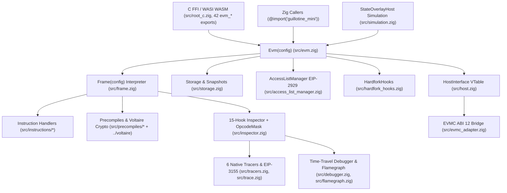

# Architecture

Guillotine Mini separates **transaction orchestration** (`Evm`), **bytecode interpretation** (`Frame`), and **external state** (`HostInterface`) so every Ethereum consensus invariant is local, auditable, and testable in isolation. See [[Overview]] and [[Decisions]].

## System Diagram

## Core Modules

| Module | File | Responsibility |
| --- | --- | --- |
| Public Entry | `src/root.zig` | Module exports consumed by Zig callers and `zevm` |
| C & WASM ABI | `src/root_c.zig` | 42 exported `evm_*` symbols, async state injection (`evm_call_ffi`, `evm_continue_ffi`), WASI reactor |
| Orchestrator | `src/evm.zig` | Transaction lifecycle, nested `CALL`/`CREATE`, checkpoints, rollback, gas refunds, warm/cold sets |
| Interpreter | `src/frame.zig` | Stack (1024 depth), dynamic memory expansion, PC, bytecode dispatch, static context propagation |
| Config | `src/evm_config.zig` | Comptime `EvmConfig` limits, opcode overrides, precompile overrides |
| Hardfork Hooks | `src/hardfork_hooks.zig` | Hardfork feature gates, gas schedules, Glamsterdam transition hooks |
| State Backend | `src/host.zig` | Pluggable `HostInterface.VTable` for balances, nonces, code, storage, account deletion |
| Storage & Access | `src/storage.zig`, `src/access_list_manager.zig` | Original vs current storage maps, EIP-1153 transient storage, EIP-2929 warm/cold sets |
| Async Executor | `src/async_executor.zig`, `src/storage_injector.zig` | Pause-and-resume execution for remote RPC / fork-state backends |
| Tracing & Inspectors | `src/trace.zig`, `src/inspector.zig`, `src/tracers.zig` | EIP-3155 JSONL traces, 15-hook zero-overhead `Inspector`, 256-bit `OpcodeMask`, 6 built-in tracers |
| Simulation & RPC | `src/simulation.zig`, `src/live_tracer.zig`, `src/trace_store.zig` | `StateOverlayHost`, `eth_call`/`estimateGas`/`createAccessList`/`simulateV1`, reorg-aware `TraceStore` |
| Devtools & EVMC | `src/debugger.zig`, `src/flamegraph.zig`, `src/evmc_adapter.zig` | Time-travel `DebugSession` (7 breakpoint types), folded/SVG gas flamegraphs, EVMC ABI 12 |

## Memory & Allocation Invariants

1. **Transaction-scoped Arena**: Ephemeral frame buffers, return data slices, and nested call states allocate from a transaction arena freed atomically at transaction end.
2. **Checkpoint Rollback**: Nested `CALL`/`CREATE` failures roll back storage mutations, logs, warm sets, created accounts, and refund counters cleanly.
3. **No Swallowed Errors**: Every Python `raise` in `execution-specs` maps to an explicit Zig error in `src/errors.zig` (`OutOfGas`, `StackOverflow`, `StackUnderflow`, `WriteProtection`, `InvalidJump`, etc.). Never `catch {}`.

## External Crypto Dependency

Guillotine Mini pins `evmts/voltaire` in `native-dependencies.json` and links `../voltaire/target/release/libcrypto_wrappers.a` (native) or `wasm32-unknown-unknown` (WASM) for Keccak256, secp256k1, BN254, BLS12-381, BLAKE2f, KZG, and P256VERIFY. See [[Hardforks-and-Specs]] and [[Decisions]].

## Related Pages

- [[Overview]]
- [[Hardforks-and-Specs]]
- [[Decisions]]
- [[Backpressure-and-Quality]]
