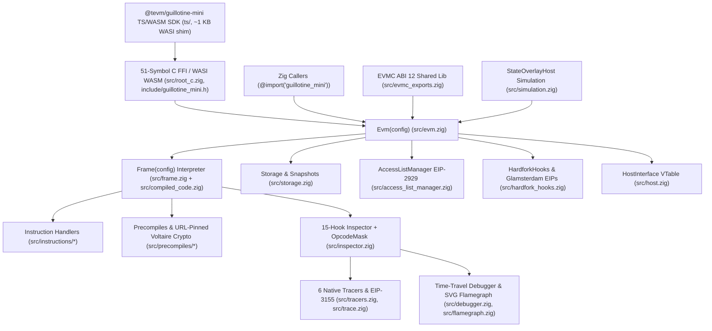

# Architecture

Guillotine Mini separates **transaction orchestration** (`Evm`), **bytecode interpretation** (`Frame` + optional `CompiledCode`), and **external state** (`HostInterface`) so every Ethereum consensus invariant is local, auditable, and testable in isolation. See [[Overview]] and [[Decisions]].

## System Diagram

## Core Modules

| Module | File | Responsibility |
| --- | --- | --- |
| Public Entry | `src/root.zig` | Module exports consumed by Zig callers (`zig fetch --save`) and `zevm` |
| C & WASM ABI | `src/root_c.zig`, `include/guillotine_mini.h` | 51 exported `evm_*` symbols, async state injection, flamegraph SVG/folded & revert decoder exports |
| EVMC ABI 12 | `src/evmc_adapter.zig`, `src/evmc_exports.zig` | Drop-in `libguillotine_mini_evmc.{so,dylib}` exporting `evmc_create_guillotine_mini()` |
| Orchestrator | `src/evm.zig` | Transaction lifecycle, nested `CALL`/`CREATE`, checkpoints, rollback, EIP-8037 2D gas, `ReusableEvm` |
| Interpreter | `src/frame.zig`, `src/compiled_code.zig`, `src/u256_math.zig` | 1024-slot stack, contiguous memory, lazy JUMPDEST bitmap, comptime-gated compiled basic blocks |
| Config | `src/evm_config.zig` | Comptime `EvmConfig` limits, `enable_compiled_interpreter`, `enable_bal_recorder`, overrides |
| Hardfork Hooks | `src/hardfork_hooks.zig` | Hardfork feature gates, EIP-7708 logs, EIP-7928 `BalRecorder`, EIP-8024, EIP-8037/8038 gas tables |
| State Backend | `src/host.zig` | Pluggable `HostInterface.VTable` for balances, nonces, code, storage, account deletion |
| Storage & Access | `src/storage.zig`, `src/access_list_manager.zig` | Original vs current storage maps, EIP-1153 transient storage, EIP-2929 warm/cold sets |
| Async Executor | `src/async_executor.zig`, `src/storage_injector.zig` | Pause-and-resume execution for remote RPC / fork-state backends |
| Tracing & Inspectors | `src/trace.zig`, `src/inspector.zig`, `src/tracers.zig` | EIP-3155 JSONL traces, 15-hook zero-overhead `Inspector`, 256-bit `OpcodeMask`, 6 built-in tracers |
| Simulation & Devtools | `src/simulation.zig`, `src/live_tracer.zig`, `src/trace_store.zig`, `src/debugger.zig`, `src/flamegraph.zig` | `StateOverlayHost`, `eth_call`/`estimateGas`/`simulateV1`, time-travel `DebugSession`, SVG flamegraphs |
| Universal TS SDK | `ts/{index,evm,wasi-shim,abi,precompiles,fork}.ts`, `cloudflare/evm-worker.ts` | Zero-dep JS/TS wrapper for browsers, Cloudflare Workers, Deno, Bun, and Node |

## Memory & Allocation Invariants

1. **Transaction-scoped Arena**: Ephemeral frame buffers, return data slices, and nested call states allocate from a transaction arena freed atomically at transaction end.
2. **Checkpoint Rollback**: Nested `CALL`/`CREATE` failures roll back storage mutations, logs, warm sets, created accounts, BAL writes (demoted to reads), EIP-8037 state gas, and refund counters cleanly.
3. **Zero-Panic Production Safety**: Zero `@panic`, zero `unreachable`, and zero empty `catch {}` in production `src/` modules. Every Python `raise` in `execution-specs` maps to an explicit Zig error in `src/errors.zig`.
4. **Comptime WASM DCE**: `src/root_c.zig` disables `enable_compiled_interpreter` and `enable_bal_recorder` on `wasm32` targets so `guillotine_mini_core.wasm` stays at `235,150 B` (`92.8 KiB` gzipped).

## External Crypto Dependency

Guillotine Mini pins `evmts/voltaire` by URL and content hash in `build.zig.zon` (mirroring `native-dependencies.json`) so standalone `zig fetch --save` works with zero sibling checkouts. Native builds lazily initialize Voltaire's embedded KZG trusted setup on EIP-4844 `0x0a` calls (gated off on `wasm32` to protect bundle budgets). See [[Hardforks-and-Specs]] and [[Decisions]].

## Related Pages

- [[Overview]]
- [[Hardforks-and-Specs]]
- [[Decisions]]
- [[Backpressure-and-Quality]]
