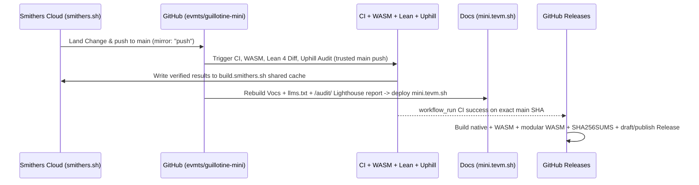

# Factory, MCP, and Operations

`evmts/guillotine-mini` operates publicly on Smithers Cloud at **[https://smithers.sh/evmts/guillotine-mini](https://smithers.sh/evmts/guillotine-mini)**, mirroring to GitHub (`evmts/guillotine-mini`). See [[Overview]], [[Trust-and-Security]], and [[Backpressure-and-Quality]].

## Personalized Factory UI (Maintainer / Contributor / Viewer)

Declared in `.smithers/HOME.ts` and projected to `.smithers/home.json` (`contributors: "role"`):

- **Viewers (`everyone`)**: See the 2-column Hero + Zig quickstart, project Stats, Why Guillotine Mini cards, Live Backpressure Audit summary (`.smithers/audit/latest.md`), Wiki & Mythical History & Tevm Stack cards, Releases, Docs tab (`https://mini.tevm.sh/llms.txt`), and Ask prompt.
- **Contributors (`contributor` — signed-in with a repo role / contribution)**: See everything Viewers see **plus** the **Contribute** section with untrusted local setup commands, one-line MCP connection commands, "How a change lands" cards, live Factory Flows catalog, and contributor quick links.
- **Maintainers (`maintainer` — `roninjin10`, `fucory`)**: See everything above **plus** the **Today** control plane (`New branch` `b` shortcut, live `Issues & PRs`, live `TODO stack`, live `Recent runs`, quick-launch App tiles, and Maintainer Operations links) and a `View as` switcher to preview Contributor and Viewer layouts.

## Authenticated Cloud MCP Server

Every agent working on `guillotine-mini` (or downstream `zevm` / `tevm`) connects to the live Streamable HTTP MCP server:

- **Endpoint**: `https://smithers.sh/evmts/guillotine-mini/mcp`
- **OAuth 2.1 Discovery**: `https://smithers.sh/.well-known/oauth-protected-resource/evmts/guillotine-mini/mcp`
- **Quick Connect**:
  ```sh
  claude mcp add guillotine-mini --transport http https://smithers.sh/evmts/guillotine-mini/mcp
  codex mcp add guillotine-mini --url https://smithers.sh/evmts/guillotine-mini/mcp
  agy mcp add guillotine-mini --transport http https://smithers.sh/evmts/guillotine-mini/mcp
  ```
- **Available MCP Tools**: `repo_tree`, `repo_read_file`, `repo_refs`, `docs_list`, `docs_read`, `flows_list`, `flow_get`, `issues_list`, `issue_get`, `issue_create`, `issue_comment`, `pulls_list`, `pull_get`, `pull_files`, `todo_list`, `work_link_post`, and fleet reporting tools.
- **Attribution**: Every MCP write is attributed as `<login> (agent)` and enforces server-side person-only guards.

## One-Time-Use Sandbox & Agent Authentication

Use `.smithers/scripts/mint-sandbox-auth.ts` to print or provision short-lived, single-use credentials for sandboxes and external agents without sharing static root secrets:

```sh
# Print one-time BYOA attach instructions + PKCE claim helper for a branch
bun .smithers/scripts/mint-sandbox-auth.ts attach --branch main

# Mint a short-lived, run-scoped gateway token (reads SMITHERS_TOKEN from env/stdin, never argv)
bun .smithers/scripts/mint-sandbox-auth.ts gateway --scope read:runs --ttl 15m --run <run-id>

# Print agent MCP bootstrap prompt (safe for untrusted contributors and sandboxes)
bun .smithers/scripts/mint-sandbox-auth.ts prompt
```

## Merge-to-GitHub Automation Loop



## Dogfooding Pipeline for ZEVM & Tevm

1. `guillotine-mini` pins `evmts/voltaire` in `native-dependencies.json`.
2. Every landing on `main` verifies the Zig module (`@import("guillotine_mini")`), 42-symbol C static library (`libguillotine_mini.a`), and WASI WASM artifacts (`guillotine_mini.wasm` + modular precompiles).
3. Downstream `zevm` consumes `guillotine-mini` directly as a Zig dependency, querying `guillotine-mini`'s docs, flows, and issues over Smithers Cloud MCP and reusing cached build results from `build.smithers.sh`.

## Related Pages

- [[Overview]]
- [[Trust-and-Security]]
- [[Backpressure-and-Quality]]
- [[Mythical-History]]
