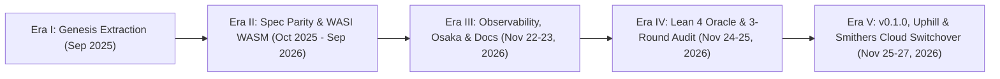

# Mythical History of Guillotine Mini

> *"From a single `zig init` extracted out of Guillotine to a formally verified, spec-first Zig EVM running publicly on Smithers Cloud."*

This chronicle traces the real, commit-verified evolution of `evmts/guillotine-mini` across **1,611+ commits on `main`**. Every milestone cites the exact historical commit SHA so humans and agents can inspect the living lineage of every architectural decision. See [[Overview]] and [[Decisions]].

## Era Timeline

## Era I: Genesis Extraction (September 30 - October 1, 2025)

- **`4e5d05e3` (2025-09-30)** — `chore: zig init`. The repository begins with a clean Zig scaffold.
- **`81ce7a60` (2025-09-30)** — `feat: extract mini EVM implementation from guillotine`. Guillotine Mini splits out as the minimal, readable, specification-first counterpart to full Guillotine, prioritizing auditable code over speculative complexity.
- **`60181a2b` & `fa840760` (2025-10-01)** — Refactors to a clean library-only package with centralized EVM errors (`c9a20c25`), WASM targets, and a dedicated test runner utility (`707c4fb4`).

## Era II: Execution-Specs Authority & WASI Reactor (2025-10 - 2026-09)

- Over more than a thousand commits, `guillotine-mini` establishes **Python `execution-specs` as the single source of truth**, building the 7-checkpoint EIP-3155 trace divergence workflow (`scripts/isolate-test.ts`, `scripts/fix-specs.ts`) and covering Frontier through Prague.
- **`edafd394` (2026-09-05)** — `fix(wasm): build and execute the WASI reactor with linked crypto`. Guillotine Mini compiles to a WASI Preview 1 WebAssembly reactor with Voltaire's Rust cryptography linked directly in, enabling portable browser and Node execution.

## Era III: Observability, Osaka, Examples & Smithers Genesis (November 22 - 23, 2026)

- **`3e9e8580` (2026-11-22)** — Complete rewrite of the Vocs documentation site (`mini.tevm.sh`) with visual architecture diagrams, Head First tutorials, K&R-style references, and an interactive browser Opcode & Gas Explorer.
- **`14288287` & `69603e3d` (2026-11-23, PR #42)** — Massive leap in production readiness: EIP-7939 `CLZ`, EIP-7951 `P256VERIFY` precompile wiring, EIP-3155 tracing fixes, the 15-hook `Inspector` API with 256-bit `OpcodeMask`, 6 native tracers, `StateOverlayHost` simulation RPC, time-travel `DebugSession`, gas flamegraphs, and EVMC ABI 12 bridge.
- **`618007ed` (2026-11-23)** — First `.smithers/` factory scaffold lands, introducing `WORKSPACE.ts`, fine-grained `PACKAGE.ts` filegroups across `src/`, `client/`, and `client-ts/`, and remote caching on `build.smithers.sh`.
- **`54be5890` & `472cf3b6` (2026-11-23)** — Modular precompile WASM splitting with strict byte budgets (<= 2.5 MiB) and 10 runnable Zig examples verified against EIP-3155 reference traces.
- **`cbc49735` (2026-11-23)** — Osaka property & fuzz suite catches and eliminates a reverted-child storage-slot resurrection bug.

## Era IV: The Lean 4 Formal Oracle & Three-Round Audit (November 24 - 25, 2026)

- **`ae8ef2d7` (2026-11-24)** — Multi-model PEAK-1 panel synthesis lands Osaka `P256VERIFY`, untruncated async C ABI, and safe `Evm.init`.
- **`5c2ae70c` & `d04d4e31` (2026-11-24)** — **Executable Lean 4 EVM Reference Specification (`spec/lean/`)** lands alongside a **14,784-vector differential fuzz suite** comparing the Zig EVM directly against machine-checked Lean 4 semantics with zero `sorry`s.
- **`a3a7a9a3`, `41408f2f`, `fc8d7133`, `f7e5da02` (2026-11-24 - 2026-11-25)** — Three full rounds of multi-lane security and correctness audits close rollback, checkpoint memory reclamation, async `EXTCODE*`/`SELFDESTRUCT` miss-handling, C handle re-entrancy, EIP-7623/7702 runner edge cases, and Osaka blob cap bugs.

## Era V: `v0.1.0`, Uphill Backpressure & Public Smithers Cloud Switchover (November 25 - 27, 2026)

- **`2264d998` (`v0.1.0`, 2026-11-25)** — First tagged public release (`v0.1.0`) with green macOS + Linux + WASM + Lean 4 + Smithers CI.
- **`0a128cae` (2026-11-26)** — Uphill continuous metrics (`safety`, `style`, `footprint`, `verification`, `documentation`) establish baselines and automated quality hill-climbing.
- **Public Smithers Cloud Switchover (2026-11-26 - 2026-11-27)** — `evmts/guillotine-mini` completes its switchover to a public Smithers Cloud coding factory at `https://smithers.sh/evmts/guillotine-mini`:
  - Personalized Maintainer / Contributor / Viewer UI (`HOME.ts` -> `home.json`) with live `mini.tevm.sh/llms.txt` Docs tab.
  - Strict trust & cache-poisoning isolation (trusted sandboxes/maintainers vs encouraged untrusted contributor runs).
  - Lighthouse-style 6-category Backpressure Audit Report published live at `https://mini.tevm.sh/audit/`.
  - Obsidian-compatible Wiki and this Mythical History synced on every merge.
  - Authenticated Cloud MCP server (`https://smithers.sh/evmts/guillotine-mini/mcp`) + one-time-use sandbox auth tooling.
  - Automated CI-gated GitHub Releases and Docs publishing on every merge from Smithers Cloud to GitHub `main`.

## Related Pages

- [[Overview]]
- [[Architecture]]
- [[Decisions]]
- [[Factory-and-Operations]]
- [[Backpressure-and-Quality]]
