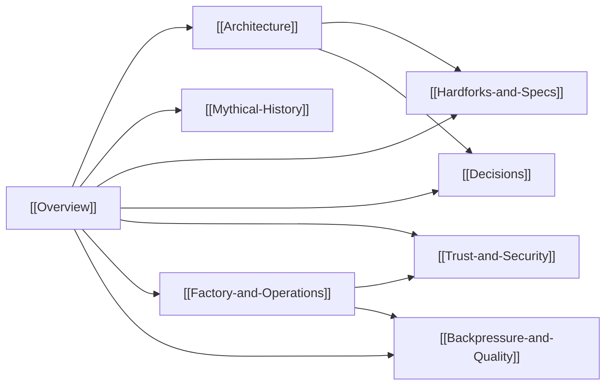

# Guillotine Mini Wiki

Welcome to the engineering knowledge base for **`evmts/guillotine-mini`**, a minimal, readable, specification-first Ethereum Virtual Machine (EVM) in Zig supporting Frontier through Osaka (with Glamsterdam hooks), native C FFI, a WASI Preview 1 WebAssembly reactor with linked Rust cryptography, and an executable Lean 4 differential oracle.

This wiki is Obsidian-compatible: every `[[wikilink]]` resolves cleanly inside Smithers Cloud's Wiki plugin (`https://smithers.sh/evmts/guillotine-mini`), local Obsidian vaults, and automated CI link checks (`bun .smithers/scripts/sync-wiki-feed.ts --check`).

## Knowledge Map

## Core Pages

- **[[Architecture]]** — Subsystem boundaries across `Evm`, `Frame`, `HostInterface`, `Storage`, `Inspector`, `Simulation`, `Debugger`, `Flamegraph`, `EVMC`, `root_c.zig`, and Voltaire crypto linkage.
- **[[Mythical-History]]** — The commit-by-commit chronicle of `guillotine-mini` from `zig init` (`4e5d05e3`) to WASI WASM, Osaka EIP-7939/7951, the Lean 4 formal oracle, `v0.1.0`, Uphill metrics, and the public Smithers Cloud factory switchover.
- **[[Hardforks-and-Specs]]** — Frontier through Osaka parity, Glamsterdam transition hooks, Python `execution-specs` authority, 7-checkpoint spec-fix debugging, and Lean 4 formal verification.
- **[[Decisions]]** — Durable Architectural Decision Records (ADRs) explaining why the engine, ABI, build graph, and factory are built the way they are.
- **[[Trust-and-Security]]** — Security-by-construction trust boundaries separating Maintainer and Smithers-controlled sandboxes from encouraged untrusted contributor runs, preventing cache poisoning and gate bypass.
- **[[Factory-and-Operations]]** — How `smithers.sh/evmts/guillotine-mini` runs publicly: personalized Maintainer/Contributor/Viewer UI, shared object store (`build.smithers.sh`), authenticated Cloud MCP server, one-time sandbox auth, and automated releases and docs publishing.
- **[[Backpressure-and-Quality]]** — The Lighthouse-style Backpressure Audit Report, Uphill 6-category continuous metrics, TigerStyle bounds, and WASM byte budgets.

## Where Guillotine Mini Sits in the Tevm Stack

| Layer | Project | Role |
| --- | --- | --- |
| Primitives & Crypto | [evmts/voltaire](https://smithers.sh/evmts/voltaire) | Ethereum types, RLP, ABI, Keccak256, secp256k1, BLS12-381, BN254, KZG, precompiles |
| Reference Readable EVM | **evmts/guillotine-mini** | Minimal spec-first Zig EVM, C/WASM ABI, Lean 4 oracle, tracing & simulation devtools |
| High-Speed Sibling EVM | [evmts/guillotine](https://guillotine.tevm.sh) | High-throughput execution engine in the Guillotine family |
| Native Execution Client | [evmts/zevm](https://zevm.tevm.sh) | Zig Ethereum execution client dogfooding Guillotine Mini directly via Smithers |
| Developer Node & SDK | [evmts/tevm](https://tevm.sh) | TypeScript Ethereum node and interactive playgrounds |
