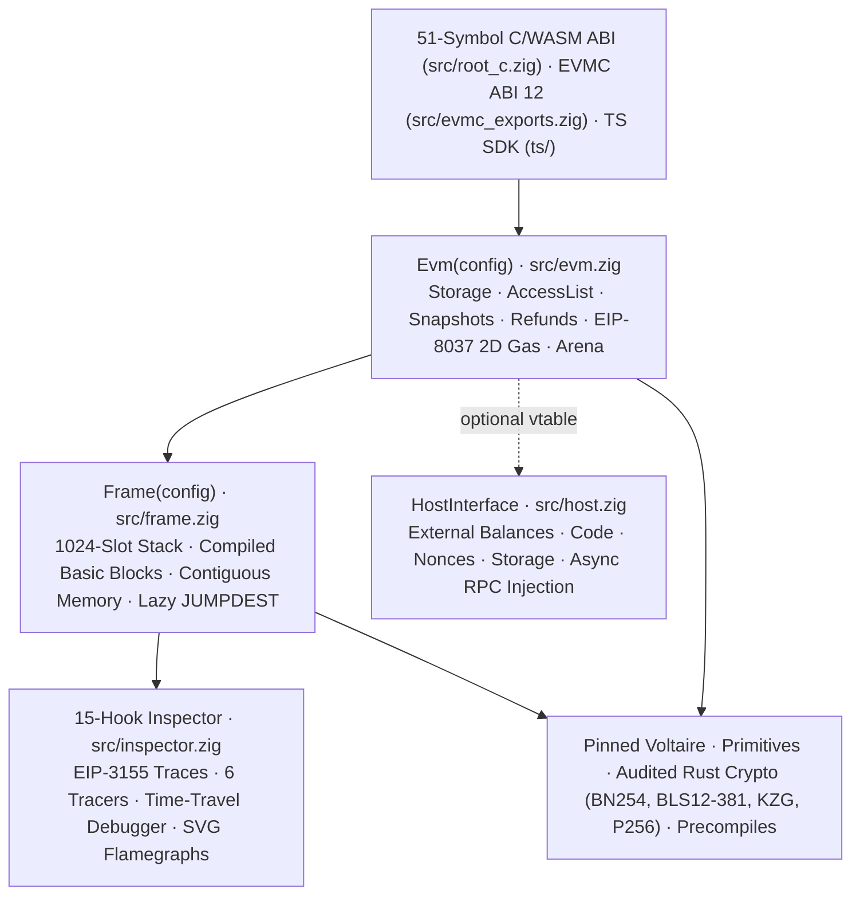

<div align="center">
  <h1>
    Guillotine Mini
    <br/>
    <sub>Minimal, formally verified, universal EVM in Zig, C, EVMC, and WebAssembly.</sub>
  </h1>
  <p>
    <a href="https://github.com/evmts/guillotine-mini">
      
    </a>
    <a href="https://github.com/evmts/guillotine-mini/actions/workflows/ci.yml">
      
    </a>
    <a href="https://github.com/evmts/guillotine-mini/actions/workflows/wasm.yml">
      
    </a>
    <a href="https://mini.tevm.sh/play">
      
    </a>
  </p>
</div>

**Guillotine Mini** is the embeddable, specification-first Ethereum Virtual Machine in the [Tevm](https://tevm.sh) stack — built to be the **"SQLite of EVMs"**: tiny, self-contained, auditable, formally verified in Lean 4, and runnable natively from Zig, C, EVMC ABI 12 hosts, Node, Bun, Deno, browsers, and Cloudflare Workers.

- **100.00% official EEST conformance (`Frontier` → `Osaka`)**: **66,652 / 66,652** official `ethereum/execution-spec-tests` (`tests@v21.0.3`) state tests passing in ~18.5 s (`zig build eest-runner`), gated on every push in CI.
- **Glamsterdam (Amsterdam) ready**: Implements EIP-7708 (ETH transfer system logs), EIP-7843 (`SLOTNUM`), EIP-7928 (revert-aware Block-Level Access List recorder), EIP-7954 (64 KiB code / 128 KiB initcode), EIP-8024 (`DUPN`/`SWAPN`/`EXCHANGE`), EIP-8037 (2D state gas reservoir), EIP-8038 (state-access repricing), and EIP-8246 (no-burn self-destruct).
- **210 machine-checked Lean 4 theorems, 0 `sorry`**: Executable Lean 4 EVM specification (`spec/lean/`) covering word arithmetic, JUMPDEST validity, multi-frame checkpoint/rollback isolation, and Glamsterdam EIP-8037 2D gas, verified against the Zig EVM across **14,784 differential vectors** (`0 mismatches`).
- **92.8 KiB gzipped modular WASM core**: Pure-JS ~1 KB WASI Preview 1 shim (works identically in browsers, Cloudflare Workers, Deno, Bun, and Node 22+), **51 C/WASM ABI exports** including live SVG/folded gas flamegraphs and ABI revert decoding.
- **Zero-friction install**: Standalone `zig fetch --save` (URL+hash pinned Voltaire — no sibling `../voltaire` checkout needed), zero-dep `@tevm/guillotine-mini` TypeScript SDK, single-header C99 API (`include/guillotine_mini.h`), and drop-in EVMC ABI 12 shared library (`zig build evmc`).
- **Live Browser Debugger**: Try the real WASM EVM with time-travel EIP-3155 stepping, SVG gas flamegraphs, and mainnet RPC replay at **[mini.tevm.sh/play](https://mini.tevm.sh/play)**.

## Quick Start

### TypeScript / JavaScript (Browser, Cloudflare Workers, Bun, Deno, Node)

```bash
npm install @tevm/guillotine-mini
```

```ts
import { createEvm, encodeCalldata } from "@tevm/guillotine-mini";

// Works in browsers, Cloudflare Workers, Deno, Bun, and Node with zero dependencies
using evm = await createEvm({
  wasm: await fetch("/wasm/guillotine_mini.wasm"),
  hardfork: "osaka",
});

// PUSH1 42, PUSH0, MSTORE, PUSH1 32, PUSH0, RETURN
const result = evm.execute({
  bytecode: "0x602a5f5260205ff3",
  gas: 100_000n,
});
console.log(result.outputHex, result.gasUsed); // 0x0000...002a, 18n

// Capture an interactive SVG gas flamegraph + EIP-3155 trace
const { svg } = evm.executeWithFlamegraph({ bytecode: "0x602a5f5260205ff3" });
```

See [ts/](ts/) for the zero-dependency SDK (`GuillotineEvm`, modular precompiles, async JSON-RPC state forking) and [cloudflare/evm-worker.ts](cloudflare/evm-worker.ts) for the edge `eth_call` / `eth_estimateGas` / `debug_traceCall` Worker.

### Zig Dependency (`zig fetch --save`)

Guillotine Mini pins `evmts/voltaire` by URL and content hash in `build.zig.zon`, so any Zig `0.15.2` project can fetch it standalone with one command:

```bash
zig fetch --save https://github.com/evmts/guillotine-mini/archive/refs/tags/v0.2.0.tar.gz
```

```zig
// build.zig
const guillotine_dep = b.dependency("guillotine_mini", .{
    .target = target,
    .optimize = optimize,
});
exe.root_module.addImport("guillotine_mini", guillotine_dep.module("guillotine_mini"));
```

Voltaire's primitives, audited Rust crypto archive, and precompiles are wired transitively. See [examples/README.md](examples/README.md) for 10 runnable Zig examples verified against EIP-3155 reference traces.

### C99 & EVMC ABI 12 Shared Library

```bash
zig build native evmc -Doptimize=ReleaseFast
# Produces:
#   zig-out/lib/libguillotine_mini.a          (51-symbol C99 static library)
#   zig-out/lib/libguillotine_mini_evmc.{so,dylib}  (EVMC ABI 12 shared VM)
#   include/guillotine_mini.h                 (C99 / C++17 header)
```

Link directly with `#include "include/guillotine_mini.h"` or load `libguillotine_mini_evmc.{so,dylib}` in any EVMC v11/v12 host (`evmc run`, Reth, Erigon, Silkworm, Besu) via `evmc_create_guillotine_mini()`.

## Build From Source

Requirements: Zig `0.15.2`, Cargo/Rust (`1.99.0`), Binaryen `wasm-opt` (`132.0.0`, for WASM builds), Node 22+ or Bun 1.4+.

```bash
git clone https://github.com/evmts/guillotine-mini.git
cd guillotine-mini

zig build unit test-trace test-evmc   # Core Zig EVM, EIP-3155 traces, EVMC ABI 12
zig build examples && sh test/examples.sh
zig build native evmc                 # C static lib + EVMC ABI 12 shared lib
zig build wasm wasm-modular test-wasm-size test-wasm
bun test ./ts/                        # Universal TS/WASM SDK & Cloudflare Worker
```

## Official Conformance & Formal Verification

### Official EEST (`tests@v21.0.3`, 66,652 State Tests)

Run all 66,652 official Ethereum Execution Spec Tests across every mainnet hardfork from Frontier through Osaka with zero Python setup:

```bash
bash scripts/fetch-eest-fixtures.sh
zig build eest-runner -Doptimize=ReleaseFast -- \
  --dir "$(bash scripts/fetch-eest-fixtures.sh --print-dir)" \
  --exclude-fork amsterdam --json
```

| Hardfork | Passed | Failed | Total |
| --- | ---: | ---: | ---: |
| Frontier | 813 | 0 | 813 |
| Homestead | 883 | 0 | 883 |
| Tangerine Whistle | 881 | 0 | 881 |
| Spurious Dragon | 961 | 0 | 961 |
| Byzantium | 2,332 | 0 | 2,332 |
| Constantinople Fix | 2,525 | 0 | 2,525 |
| Istanbul | 2,652 | 0 | 2,652 |
| Berlin | 3,593 | 0 | 3,593 |
| London | 3,874 | 0 | 3,874 |
| Paris | 3,889 | 0 | 3,889 |
| Shanghai | 4,088 | 0 | 4,088 |
| Cancun | 11,578 | 0 | 11,578 |
| Prague | 13,919 | 0 | 13,919 |
| Osaka | 14,664 | 0 | 14,664 |
| **Total (Frontier → Osaka)** | **66,652** | **0** | **66,652 (100.00%)** |

Filter individual tests with `TEST_FILTER` regexes (`.*`, `(a|b)`, `[^...]`):

```bash
TEST_FILTER="(push0|mcopy)" zig build specs
```

### Lean 4 Formal Specification & Differential Oracle (`spec/lean/`)

The [Lean 4 reference specification](spec/lean/README.md) contains **210 machine-checked theorems** with **0 `sorry`** and **0 custom axioms**, covering:

- `EvmSpec/Theorems.lean` (66 theorems): 256-bit arithmetic, signed division, memory expansion, JUMPDEST bitmap soundness, EIP-2200/3529 SSTORE gas & refund bounds.
- `EvmSpec/MultiFrame.lean` (68 theorems): multi-frame call-tree checkpoints, revert rollback isolation, EIP-1153 transient storage, EIP-2929 warm-set rollback, EIP-161 RIPEMD-160 exception, EIP-6780 same-tx creation.
- `EvmSpec/AmsterdamGas.lean` (76 theorems): Glamsterdam EIP-8037 3-register LIFO state gas reservoir conservation, child spill/refund accounting, EIP-7825 execution cap, EIP-7954 64 KiB/128 KiB limits, EIP-8024 immediate encoding.

With Elan installed, verify 14,784 differential vectors against the Zig EVM:

```bash
LEAN_DIFF_REQUIRE=1 zig build lean-diff -Doptimize=ReleaseFast
```

## WebAssembly Footprint & Benchmarks

Measured via `node bench/wasm-compare.mjs` (Node v26.5.0, `ReleaseSmall` + `wasm-opt -Oz`):

| Artifact / Workload | Metric |
| --- | --- |
| `guillotine_mini_core.wasm` (modular core, 51 C ABI exports, Frontier → Amsterdam) | **235,150 B raw** / **92.8 KiB gzip** |
| `guillotine_mini.wasm` (all-in-one reactor with linked BN254, BLS12-381, P256VERIFY) | **595,191 B raw** / **236.7 KiB gzip** |
| `precompile-100.wasm` (standalone Osaka EIP-7951 P256VERIFY) | **41,634 B raw** / **16.9 KiB gzip** |
| Cold instantiate (`core` / `full`) | **0.286 ms** / **0.318 ms** median |
| Warm contract call (`PUSH1 42 ... RETURN`) | **4.19 µs** median |
| Warm 500-iteration EVM loop | **73.57 µs** median |
| Osaka EIP-7939 `CLZ` (32 iterations) | **2.73 µs** median |

Every modular precompile (`01`..`11` + `100`) and both reactors are enforced by `zig build test-wasm-size` in CI (`wasm.yml`).

```bash
# Build just the 92.8 KiB gzipped core + SHA-256 precompile
zig build wasm-core wasm-precompile-02
```

## Architecture



## Backpressure & Smithers Cloud Factory

Guillotine Mini runs publicly as a Smithers Cloud coding factory at **[smithers.sh/evmts/guillotine-mini](https://smithers.sh/evmts/guillotine-mini)** with a live **Lighthouse Backpressure Audit Report** at **[mini.tevm.sh/audit/](https://mini.tevm.sh/audit/)**:

```bash
uphill --compact                                    # 6-category continuous quality metrics
bun .smithers/scripts/generate-audit-report.ts      # Lighthouse HTML/JSON/MD audit report
bun .smithers/scripts/sync-wiki-feed.ts --check     # Obsidian wiki & Mythical History checks
bun test ./.smithers/scripts/                       # Trust, auth, home, audit & wiki tests
```

## Docs & Resources

- **Documentation & Live Playground**: [mini.tevm.sh](https://mini.tevm.sh) · [mini.tevm.sh/play](https://mini.tevm.sh/play) · [mini.tevm.sh/audit/](https://mini.tevm.sh/audit/)
- [CONTRIBUTING.md](CONTRIBUTING.md) — setup, test suites, and contribution workflow
- [NATIVE_RELEASE.md](NATIVE_RELEASE.md) — native ZEVM embedding notes
- [CLAUDE.md](CLAUDE.md) — deep EVM debugging guide (7-checkpoint spec-fix method, Lean 4 oracle)
- [Glamsterdam hardfork roadmap](docs/HARDFORK_ROADMAP.md) — audit baseline and staged implementation
- [Voltaire](https://github.com/evmts/voltaire) · [ZEVM](https://zevm.tevm.sh) · [Guillotine](https://github.com/evmts/guillotine) · [Tevm](https://tevm.sh)

## License

See [LICENSE](LICENSE).
