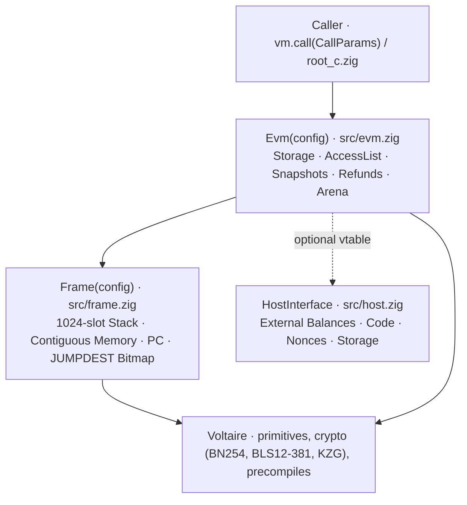

<div align="center">
  <h1>
    Minimal, spec-compliant EVM in Zig.
    <br/>
    <br/>
  </h1>
  <sup>
    <a href="https://github.com/evmts/guillotine-mini">
       
    </a>
    <a href="https://github.com/evmts/guillotine-mini/actions/workflows/ci.yml">
      
    </a>
    <a href="https://github.com/evmts/guillotine-mini/actions/workflows/wasm.yml">
      
    </a>
  </sup>
</div>

> We are actively building a full Ethereum execution client (Guillotine) on top of this EVM. Guillotine-mini remains the core execution engine.

## Requirements

- Zig 0.15.1+ (CI uses 0.15.2)
- Cargo (Voltaire builds its Rust crypto archive)
- A `../voltaire` checkout at the revision pinned in `native-dependencies.json`
- Python 3 and [uv](https://docs.astral.sh/uv/) for `zig build test` and `zig build specs` (execution-specs fills fixtures with Python 3.11+)
- Binaryen `wasm-opt` for building either WASM EVM reactor (CI uses 132.0.0)
- Node 22+ for `zig build test-wasm` and `examples/wasm.mjs`

## Install

**Build from source**

`build.zig.zon` resolves Voltaire (primitives, crypto, precompiles) from the
adjacent `../voltaire` directory. Clone both repositories side by side and check
out the Voltaire revision pinned in `native-dependencies.json`:

```bash
git clone --recurse-submodules https://github.com/evmts/guillotine-mini.git
git clone https://github.com/evmts/voltaire.git
git -C voltaire checkout "$(jq -r .voltaire.revision guillotine-mini/native-dependencies.json)"
cd guillotine-mini
zig build
```

The first build runs Cargo inside `../voltaire` to compile the Rust crypto
archive. Plain `zig build` installs no artifacts; use `zig build native` for the
C ABI static library and `zig build wasm` for the WASI reactor.

`zig build test` runs the unit tests and the execution-specs state tests. It reads
fixtures from the `execution-specs` and `ethereum-tests` submodules and, on the
first run, uses `uv` to fill the execution-specs fixtures and `python3` to generate
the spec test wrappers. If you cloned without submodules, run
`git submodule update --init execution-specs ethereum-tests`. The Nethermind
trie diff runs only when `dotnet` is installed; pass `-Dnethermind-diff=false` to
skip it explicitly.

**Use as a Zig dependency**

Because `build.zig.zon` points at `../voltaire`, consume Guillotine Mini as a
path dependency from a sibling checkout. `zig fetch --save` of a GitHub tarball
fails with `dependency path outside project`. Place your project next to the
`guillotine-mini` and `voltaire` checkouts above, then declare both in your
`build.zig.zon`:

```zig
.dependencies = .{
    .guillotine_mini = .{ .path = "../guillotine-mini" },
    .voltaire = .{ .path = "../voltaire" },
},
```

```zig
const guillotine_dep = b.dependency("guillotine_mini", .{
    .target = target,
    .optimize = optimize,
});
const voltaire_dep = b.dependency("voltaire", .{
    .target = target,
    .optimize = optimize,
});
exe.root_module.addImport("guillotine_mini", guillotine_dep.module("guillotine_mini"));
exe.root_module.addImport("voltaire", voltaire_dep.module("primitives"));
```

Voltaire's modules carry the Rust crypto archive and its system libraries, so no
extra `linkLibrary` calls are needed. The `voltaire` import is only required if
your code constructs `Address` values or uses other Voltaire primitives directly.

## Quick Start

Run a value-transferring contract call with `zig build run-simple-call`.
The [Zig examples](examples/README.md) include nine more runnable programs and their expected output.

```bash
zig build
zig build test
zig build specs
zig build wasm
zig build test-wasm
```

```bash
TEST_FILTER="push0" zig build specs
```

## WebAssembly

The WASM build uses the adjacent `../voltaire` checkout and the same Zig and
Cargo toolchain as the native build. Install Rust's WASM standard library and Binaryen once:

```bash
rustup target add wasm32-unknown-unknown
npm install --global --ignore-scripts binaryen@132.0.0
zig build wasm
zig build test-wasm
node examples/wasm.mjs
```

`zig build wasm` builds the Rust crypto archive automatically and writes
`zig-out/bin/guillotine_mini.wasm`. The example returns a 32-byte word containing
42 and reports 18 gas used. The test and example require Node 22 or newer and
have no npm dependencies.

The artifact is a **WASI Preview 1 reactor**. Supply a WASI implementation and
call `_initialize` once before using the C API; Node's `WASI.initialize(instance)`
does this. Browser hosts need a WASI Preview 1 adapter. Crypto precompiles are
linked into the module, including BN254 and BLS12-381; no JavaScript crypto
callbacks are required. The two `env` imports, `js_opcode_callback` and
`js_precompile_callback`, select the built-in implementation when they return 0.

Use `evm_alloc(length)` and `evm_free(pointer, length)` for host transfer buffers.
Zero-length allocation returns 0; freeing a null pointer is a no-op. Input setters
copy buffers, so the host can release them after the call. Recreate typed-array
views after allocations or EVM calls because WebAssembly memory may grow.
Call `evm_destroy(handle)` when finished with an instance. See the complete
[Node example](examples/wasm.mjs) and [execution regression tests](test/wasm.test.mjs).

### Small bundle with optional precompiles

Ship `guillotine_mini_core.wasm` and only the precompile modules your workload
uses. To build the core and SHA-256 (Ethereum address `0x02`), run:

```bash
zig build wasm-core wasm-precompile-02
```

The files are installed in `zig-out/bin/`. Targets use lowercase hex addresses
(`01` through `11`, plus `100`). `zig build wasm-modular` builds all 18 modules.
The core keeps the same EVM C API, custom callbacks and hardfork activation rules.
Calling an active precompile whose module was omitted throws a host error. For
arbitrary contracts, supply all modules or use the all-in-one reactor.

For example, run this ES module from the output directory with Node 22+:

```js
import { readFile } from 'node:fs/promises'
import { WASI } from 'node:wasi'
import { precompileImports } from './precompiles.mjs'

async function reactor(file, imports = {}) {
  const wasi = new WASI({ version: 'preview1' })
  const { instance } = await WebAssembly.instantiate(await readFile(file), {
    wasi_snapshot_preview1: wasi.wasiImport, ...imports,
  })
  wasi.initialize(instance)
  return instance
}

const sha256 = await reactor('precompile-02.wasm')
const core = await reactor('guillotine_mini_core.wasm', {
  env: { js_opcode_callback: () => 0, js_precompile_callback: () => 0 },
  precompiles: precompileImports(() => core.exports.memory, [sha256]),
})
```

`zig build test-wasm-size` checks the uncompressed byte lengths of the core,
the all-in-one reactor and each precompile before CI publishes the artifacts.
The core budget is 230,721 bytes, the size recorded in the October 2025 report.

## Architecture



## Benchmarks (Incremental via Smithers)

Performance benchmarks cover every Zig core EVM module, Zig client subsystem, WASI WASM reactor, C-FFI bridge, and TypeScript / `client-ts` package. Each module declares fine-grained `PACKAGE.ts` targets so Smithers only re-runs benchmarks whose dependencies changed and replays cached output on hits:

```bash
# Full incremental CI (benchmarks are exclusive and omitted)
smthrs ci '//...'

# Run only tests and benchmarks affected by your current changes
smthrs affected test '//...' --include-exclusive --verbose

# Run a single module benchmark
smthrs test //:bench_opcodes --verbose
smthrs test //client/rpc:bench --verbose
smthrs test //client-ts/txpool:bench --verbose

# View unified summary across all collected JSON benchmark reports
smthrs run //:bench_summary

# Or run Zig benchmarks directly
zig build bench -Doptimize=ReleaseFast
```

## Docs

- **Documentation site (`docs/`):** [mini.tevm.sh](https://mini.tevm.sh) — architecture, Head First–style tutorials, interactive opcode stepper, and K&R API reference (`cd docs && npm ci && npm run dev`)
- `CONTRIBUTING.md` — setup, test suites, and contribution workflow
- `NATIVE_RELEASE.md` — native ZEVM embedding notes
- `CLAUDE.md` — project guide for devs and AI assistants

## Highlights

- Full hardfork support (Frontier → Osaka)
- 20+ EIPs implemented (EIP-1153, EIP-2537, EIP-4844, EIP-6780, EIP-7702, EIP-7939 `CLZ`, EIP-7951 `P256VERIFY`)
- Bounded EIP-3155 tracing (`Tracer.max_entries`) and `TraceDiff`
- WASI Preview 1 WASM reactor with linked crypto precompiles (`zig build wasm`)
- Flat C ABI static archive (`zig build native`)

## More

- Voltaire (primitives & crypto): https://github.com/evmts/voltaire
- Guillotine (full client): https://github.com/evmts/guillotine
- Tevm (TypeScript tooling): https://tevm.sh

## License

See `LICENSE`.
